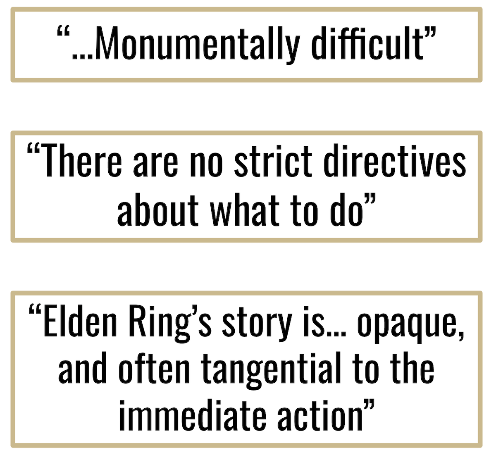
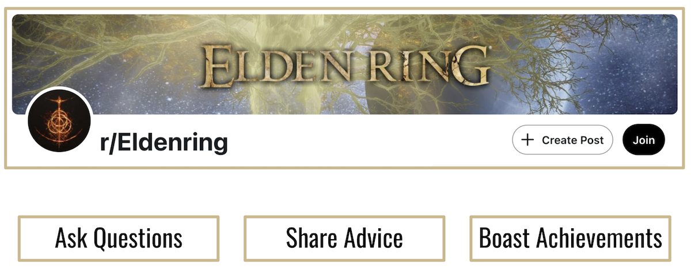
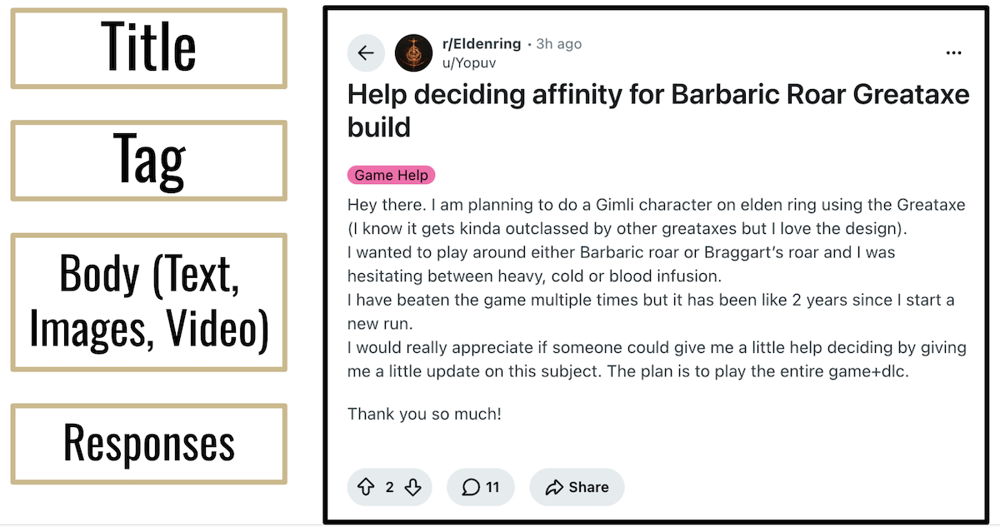
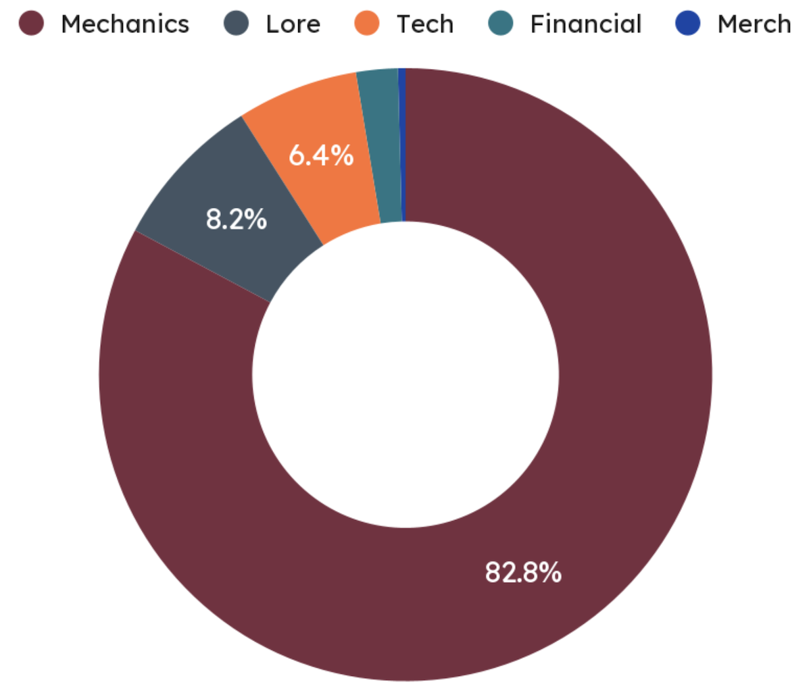
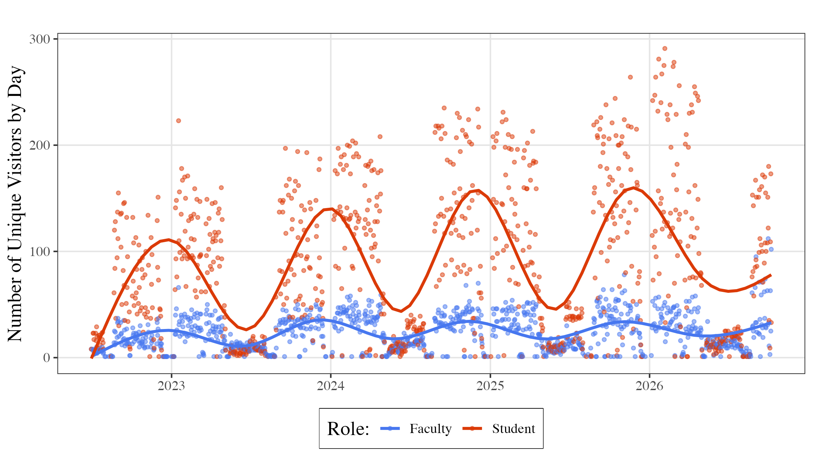
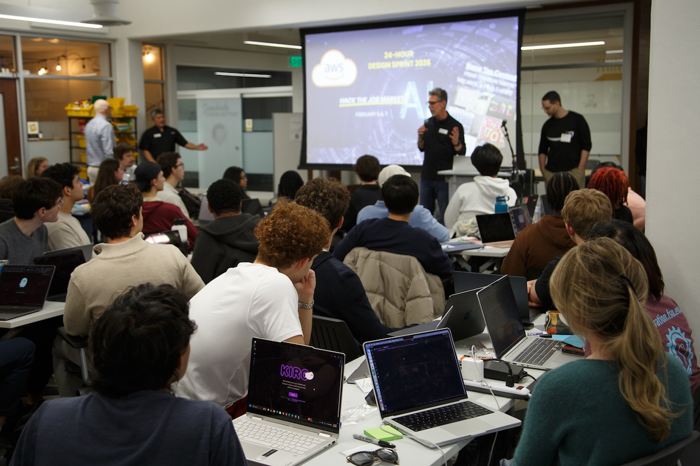
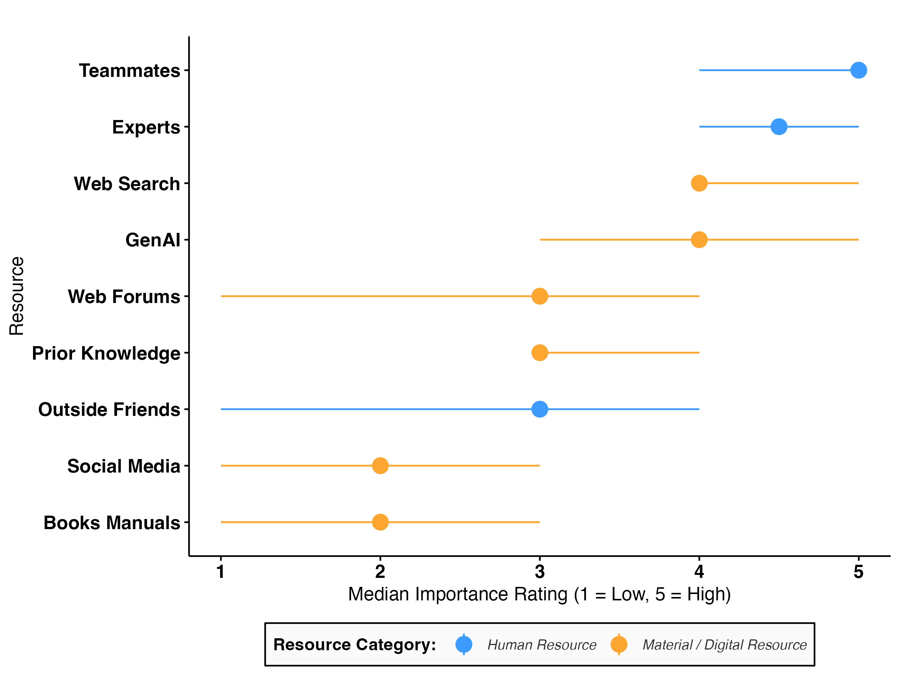
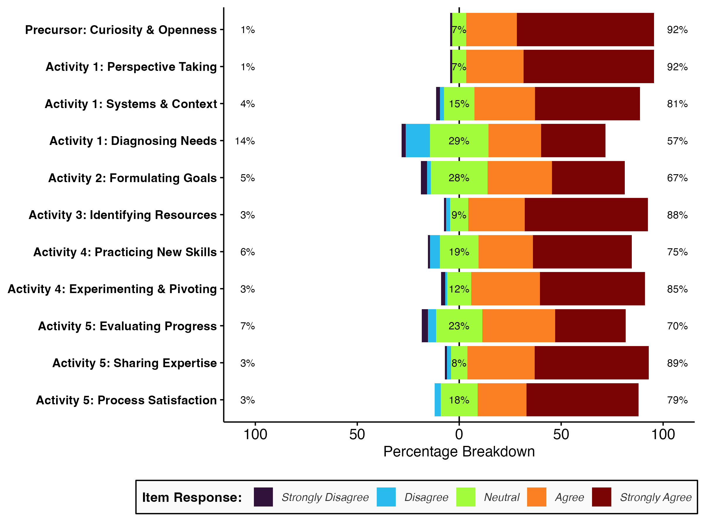
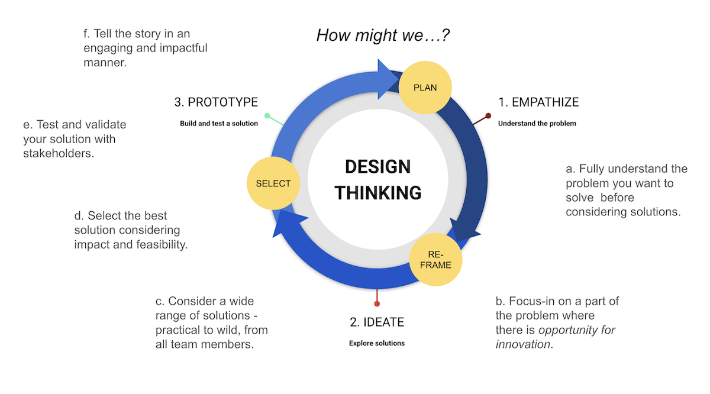
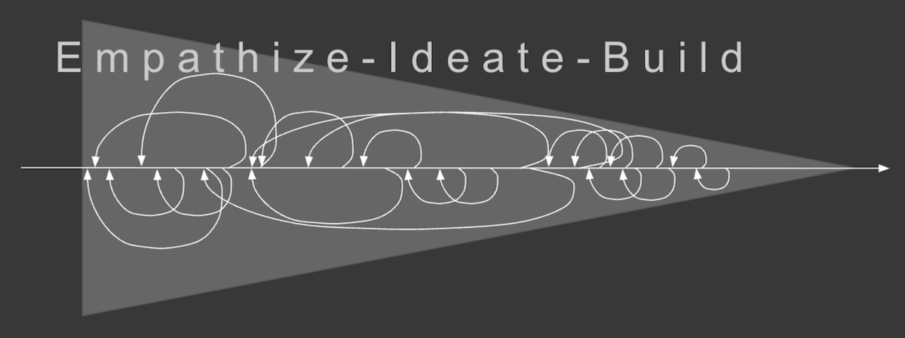

```{r setup, include=FALSE}
usethis::use_git_ignore(c("*.csv", "*.rds"))
options(htmltools.dir.version = FALSE)

library(knitr)
library(tidyverse)
library(xaringan)
library(fontawesome)
```

class: inverse, center, middle

# `r fa("fas fa-images", fill = "#fff")`

**View the slides:** 

[bretsw.com/nwu26-workshop1](https://bretsw.com/nwu26-workshop1/)


---

class: inverse, center, middle

# `r fa("far fa-map", fill = "#fff")` <br><br> Part 1:<br>Workshop Purpose


---

class: inverse, center, middle

# `r fa("fas fa-quote-left", fill = "#fff")` 1. Knowles' Definition of SDL

“In its broadest meaning, ‘self-directed learning’ describes a process in which individuals take the initiative, with or without the help of others, in diagnosing their learning needs, formulating their learning goals, identifying human and material resources for learning, choosing and implementing appropriate learning strategies, and evaluating learning outcomes.” (Knowles, 1975, p. 18)

Knowles, M. S. (1975). *Self-directed learning: A guide for learners and teachers*. Cambridge, The Adult Education Company.

---

# `r fa("fas fa-mountain-sun", fill = "#fff")` 1. SDL Activities

.pull-left-70[
```{r, out.width = "100%", echo = FALSE, fig.align = "center"}

```
]

.pull-right-30[

1. Diagnosing their learning needs

2. Formulating their learning goals

3. Identifying human and material resources for learning

4. Choosing and implementing appropriate learning strategies

5. Evaluating learning outcomes

]


---

# `r fa("fas fa-gamepad", fill = "#fff")` 1. Study 1: Elden Ring

```{r, out.width = "80%", echo = FALSE, fig.align = "center"}

```

### Massively popular video game

---

# `r fa("fas fa-gamepad", fill = "#fff")` 1. Study 1: Elden Ring

```{r, out.width = "60%", echo = FALSE, fig.align = "center"}

```

### Massively difficult video game

---

# `r fa("fas fa-gamepad", fill = "#fff")` 1. Study 1: Elden Ring

```{r, out.width = "70%", echo = FALSE, fig.align = "center"}

```

```{r, out.width = "70%", echo = FALSE, fig.align = "center"}

```

---

# `r fa("fas fa-gamepad", fill = "#fff")` 1. Study 1: Elden Ring

.pull-left-70[
```{r, out.width = "100%", echo = FALSE, fig.align = "center"}

```
]

--

.pull-right-30[

### Key Points:

- All evidence of SDL in r/Eldenring seems to be resource-related.

- How to detect other SDL activities? (TOMORROW!)

]


---

# `r fa("fab fa-unity", fill = "#fff")` 1. Study 2: Innovation Hub

```{r, out.width = "90%", echo = FALSE, fig.align = "center"}

```

### Unique Student and Faculty Visitors to the Innovation Hub by Day

---

# `r fa("fab fa-unity", fill = "#fff")` 1. Study 2: Innovation Hub

```{r, out.width = "70%", echo = FALSE, fig.align = "center"}

```

### SDL in Intensive Events

"Florida State University students build AI career tools in 24-hour sprint with Amazon Web Services"

[Link to FSU News Article](https://news.fsu.edu/news/science-technology/2026/02/19/florida-state-university-students-build-ai-career-tools-in-24-hour-sprint-with-amazon-web-services/)

---

# `r fa("fab fa-unity", fill = "#fff")` 1. Study 2: Innovation Hub

```{r, out.width = "75%", echo = FALSE, fig.align = "center"}

```

### SDL Supports During Intensive Events at the Innovation Hub

---

# `r fa("fab fa-unity", fill = "#fff")` 1. Study 2: Innovation Hub

```{r, out.width = "75%", echo = FALSE, fig.align = "center"}

```

### Self-Reported SDL During Intensive Events at the Innovation Hub

*Why not needs and goals? What about evaluation?*


---

class: inverse, center, middle

# `r fa("far fa-map", fill = "#fff")` <br><br> Precipitating Problem

**"Choosing and implementing appropriate learning strategies"**

---

# `r fa("far fa-map", fill = "#fff")` 1. Workshop Purpose

```{r, out.width = "60%", echo = FALSE, fig.align = "center"}

```

--

- Arrive at a deeper understanding of the SDL activity of **Choosing and Implementing Learning Strategies**

--

-	Identify key factors for self-directed learners who are choosing and implementing learning strategies

--

(perhaps reflecting a bit on the historical debate about Instructional Strategies: Clark vs. Kozma)


---

class: inverse, center, middle

# `r fa("fas fa-circle-notch", fill = "#fff")` <br><br> Part 2:<br>Intro to Design Thinking

---

# `r fa("fas fa-circle-notch", fill = "#fff")` 2. Design Thinking

```{r, out.width = "100%", echo = FALSE, fig.align = "center"}

```

### innovation.fsu.edu/design

---

# `r fa("fas fa-circle-notch", fill = "#fff")` 2. Design Thinking

```{r, out.width = "100%", echo = FALSE, fig.align = "center"}

```

### innovation.fsu.edu/design


---

class: inverse, center, middle

# `r fa("fas fa-users", fill = "#fff")` <br><br> Part 3:<br>Grouping

---

# `r fa("fas fa-users", fill = "#fff")` 3. Grouping

.pull-left-70[
```{r, out.width = "100%", echo = FALSE, fig.align = "center"}

```
]

.pull-right-30[

- **Find Your Team**

  - Online participants are a group

  - Those sitting around a table are a group

- **Pick Your SDL Focus**

  - Start working on a "How might we?" prompt
  
]


---

class: inverse, center, middle

# `r fa("fas fa-magnifying-glass", fill = "#fff")` <br><br>Part 4:<br>Identifying Needs and Goals

---

# `r fa("fas fa-magnifying-glass", fill = "#fff")` 4. Learning Needs and Goals

.pull-left-70[
```{r, out.width = "100%", echo = FALSE, fig.align = "center"}

```
]

.pull-right-30[

- **What are the learning needs related to your SDL topic?**

- **What are some related learning goals?**

]


---

class: inverse, center, middle

# `r fa("fas fa-street-view", fill = "#fff")` <br><br> Part 5:<br>Choosing and Implementing Appropriate Learning Strategies 

---

# `r fa("fas fa-street-view", fill = "#fff")` 5. Learning Strategies 

.pull-left-70[
```{r, out.width = "100%", echo = FALSE, fig.align = "center"}

```
]

.pull-right-30[

**Helping self-directed learners choose and implement strategies:**

- What are some key factors for self-directed learners who are choosing and implementing learning strategies?

- From these factors, what learning strategies model could we construct to help self-directed learners?

]


---

class: inverse, center, middle

# `r fa("far fa-comments", fill = "#fff")` <br><br> Part 6:<br>Reports, Evaluation, and Model Building

---

# `r fa("far fa-comments", fill = "#fff")` 6. Reports

.pull-left-70[
```{r, out.width = "100%", echo = FALSE, fig.align = "center"}

```

### [Miro board](https://miro.com/app/board/uXjVEPGCpuw=/?share_link_id=418103950265) for taking notes
]

.pull-right-30[

**Helping self-directed learners choose and implement strategies:**

- What are some key factors for self-directed learners who are choosing and implementing learning strategies?

- From these factors, what learning strategies model could we construct to help self-directed learners?

]


---

class: inverse, center, middle

# `r fa("fas fa-question", fill = "#fff")` <br><br> What should we<br>talk more about?

<hr>

<br><br><br><br><br>

**Bret Staudt Willet** <br><br> Florida State University (USA)

`r fa("envelope", fill = "#fff")` [bret.staudtwillet@fsu.edu](mailto:bret.staudtwillet@fsu.edu) | `r fa("globe", fill = "#fff")` [bretsw.com](https://bretsw.com/) | `r fa("fab fa-github", fill = "#fff")` [github.com/bretsw](https://github.com/bretsw/)